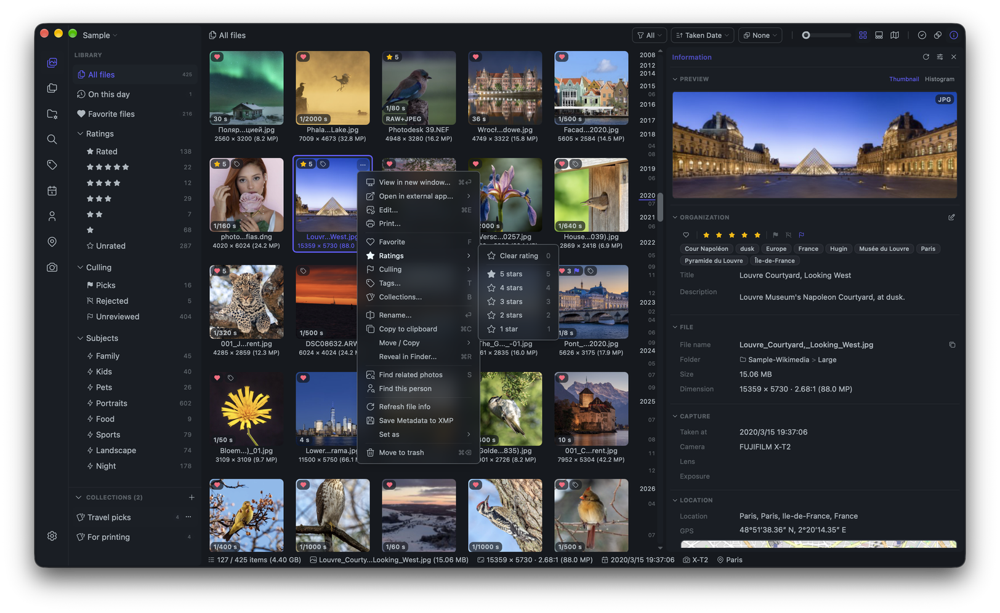
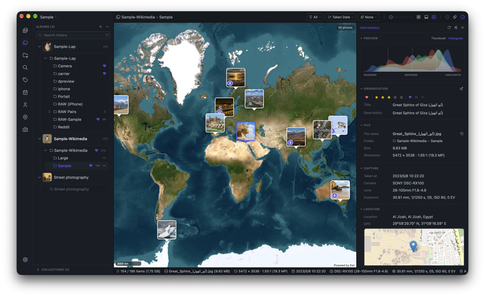

<div align="center">
  
  <h1>lappp — 本地优先的私人相册管理器</h1>
  <p><strong>julyx10/lap</strong> v0.4.0 的 fork：保留上游的全部看图能力，补上服务化形态、云端图片理解与精确搜索，并把「同步上游」变成有门禁的工程流程。</p>
  <p>
    <a href="https://github.com/viccom/lappp"></a>
    <a href="https://github.com/julyx10/lap"></a>
  </p>
</div>

> 上游项目：[julyx10/lap](https://github.com/julyx10/lap)（GPL-3.0-or-later）。
> 本仓库是它的下游 fork，产品名 `lappp`；上游的作者与版权声明保留在 [`APP_AUTHORS`](src-tauri/tauri.conf.json) 与 [`THIRD_PARTY_NOTICES.txt`](THIRD_PARTY_NOTICES.txt) 中。
> 本文件描述 **本 fork 的现状**；仓库根 `i18n/README.*.md` 是上游的多语言译本，`docs/guide/` 与 `docs/.vitepress/` 同属上游文档站。

---

## 这是什么

`lappp` 是一个**离线优先**的本地相册管理器：直接打开你已有的照片文件夹，不导入、不上传、不订阅，评分与标签可回写标准 XMP sidecar。本 fork 在此之上做了三件事：

1. **服务化**——把「本地库」拆成可远程访问的服务端 + 浏览器/瘦客户端，局域网内手机、平板、其他电脑都能看同一个库；
2. **图片理解（F1）**——可选的云端 VL（视觉语言）模型，给照片生成描述、标签，并让「按内容搜索」真正可用；
3. **搜索扩展（F2）**——FTS5 精确检索（自研中文双字切分，零新依赖）+ 描述向量语义检索 + 三档统一搜索。

---

## 三种运行形态

| 产物 | 构建方式 | 作用 | 数据目录 |
|---|---|---|---|
| `lappp.exe` | `cargo build -p lappp`（默认 `embedded`） | **厚版桌面**：内嵌 `lappp-core`，本机索引、AI、看图、编辑全包 | release：`%LOCALAPPDATA%\com.julyx10.lap`；debug：`…\com.julyx10.lap.debug` |
| `lappp-client.exe` | `cargo build -p lappp --no-default-features --features client` | **瘦客户端**：不链 `lappp-core`（不编译 libraw/libjpeg/libheif/AI 栈，16MB vs 165MB），只负责连远端 `lappp-server` | 同上（服务器列表存 `lappp-servers.json`） |
| `lappp-server.exe` | `cargo build -p lappp-server` | **无头服务端**：axum HTTP 服务，同时可托管 Web/PWA 前端 | `--data-dir` 指定的目录 |

三种形态共用同一份前端代码，通过 `src/common/transport/` 这一层「传输缝」切换：桌面走 Tauri IPC，Web 走 `POST /api/cmd/{name}` + SSE。

**服务端能力**（`crates/lappp-server`）：

- `GET /api/server_info` · `POST /api/cmd/{name}`（234 条桥接命令，权限分 read/write/admin）
- `GET /api/events`（SSE，30 秒重放环 + 15 秒心跳 + `Last-Event-ID` 续传）
- 媒体链路：`/api/thumb|preview|original|video` + `POST /api/media/sign`（HMAC 签名 URL，支持 Range/206）
- 鉴权：Argon2id 管理员口令 + 6 位配对码 → 设备令牌（Cookie `lapd_token` / Bearer）；登录限速 5 次/分/IP、5 次失败锁定 5 分钟

```bash
lappp-server --host 127.0.0.1 --port 17860 --data-dir <DIR> --web-dir <WEB_BUILD>
lappp-server --set-admin-password <PW>   # 首次设置，之后拒绝再次设置
```

---

## 截图

<p align="center">
  
  
  
  
</p>

## 相对上游的自有特性
| 特性 | 说明 | 主要位置 |
|---|---|---|
| **图片理解（VL）** | 走 Anthropic Messages 兼容网关（也可切 OpenAI Chat Completions），不可变提示词模板 + 带溯源的调用台账；识别出的标签写入「AI理解」标签树，不覆盖手写标签 | `crates/lappp-core/src/t_vl*.rs`、`src-vite/src/views/VlLab.vue` |
| **精确搜索（FTS5）** | 自研中文双字切分（bigram→单字放宽），零新依赖；文件名/元数据/标签/人名/描述全字段索引 | `crates/lappp-core/src/t_fts.rs`、`src/common/searchMode.js` |
| **AI 搜索** | 精确 / 语义 / 全部三档，双路结果按 file id 去重，语义档走图片描述向量 | `src/common/aiSearch.js`、`src/components/AiSearchPanel.vue` |
| **主题（Subjects）** | 8 个 CLIP 语义主题（家庭/孩子/宠物/人像/美食/运动/风景/夜景），侧栏计数取自主题自己的 CLIP 查询 | `src/common/smartTags.ts`、`src/components/Content.vue` |
| **Web / PWA** | 同一套 Vue 应用可构建为 PWA（manifest + Service Worker，API 请求不进缓存） | `src-vite/public/manifest.webmanifest`、`sw.js` |
| **同步门禁体系** | 类型基线门禁（当前 **0 错**）、36 域聚合测试、跨文件契约对账器、真机 CDP 冒烟 | `scripts/typecheck-gate.mjs`、`check-cross-refs.mjs`、`run-frontend-tests.mjs`、`smoke-desktop.mjs` |

---

## 功能

**浏览与组织**：多库、按日期/文件夹/地点/相机/镜头/标签/评分/人脸浏览；文件夹优先工作流（拖拽导入导出、批量改名、文件系统同步、移动/复制/删除的 XMP 与成组资产一致性）；层级标签树（可拖拽排序、子树计数）；合集；智能相册（规则 + 自定义分组排序）。

**看图与修图**：四种网格布局（卡片/平铺/瀑布流/自适应）、四宫格对比、即时预览、AF 区域叠加、裁剪/旋转/拉直/翻转/缩放/基础调色、拼贴（网格/马赛克/堆叠三种版式）。

**AI**：本地 CLIP 文本-图像检索（可下载多语言塔，50+ 语言）、相似图、人脸聚类与聚类阈值、RAW 缩略图与 RAW+JPEG 配对显示。

**元数据**：读取 EXIF/IPTC/XMP 与 sidecar（Lightroom/digiKam/darktable/ACDSee 兼容），sidecar 优先于内嵌值；**「保存元数据到 XMP」**回写标签/评分/收藏/选片状态/标题/描述/作者/版权，且保留无关属性。

**其他**：Apple Live Photo 与 Google Motion Photo、离线相册浏览（断网/网盘仍可见并显示缓存缩略图）、云端占位文件（OneDrive Files On-Demand、macOS dataless）**只索引不自动下载**、明暗主题、60+ 格式（见下）。

---

## 获取与运行

本 fork **不发布安装包**（自动更新已关闭，见下文「与上游的差异」）。目前的使用形态是源码构建 + 便携目录。

### Windows 便携测试形态

```powershell
# 1) 装依赖（Node 20+ / pnpm 9 / Rust stable / tauri-cli ^2 / cmake / nasm）
git clone --recursive https://github.com/viccom/lappp.git
cd lappp
git submodule update --init --recursive

# 2) 模型（CLIP 文本塔/视觉塔、RetinaFace、MobileFaceNet，SHA-256 校验）
./scripts/download_models.ps1

# 3) 前端依赖 + 三个 Windows 二进制
cd src-vite; pnpm install; cd ..
pwsh -File scripts/build-windows.ps1 -BuildProfile debug     # → build\windows\debug\
```

`scripts/build-windows.ps1` 默认 `-BuildProfile release`（产品形态，产物在 `build\windows\`）；`-BuildProfile debug` 产物在 `build\windows\debug\`。**两者数据目录不同、产物不互相覆盖**：debug 读 `com.julyx10.lap.debug`，release 读 `com.julyx10.lap`。

便携带走时把 `lappp.exe` + `models/` + `ffmpeg/` 放同一目录即可（资源路径按 exe 目录解析）。

### 其他平台

macOS / Linux 走上游的 `cargo tauri dev` / `cargo tauri build` 流程（依赖见上游 README：nasm、cmake、pkg-config、libheif 1.17+；`LAP_SYSTEM_LIBHEIF=1` 可改链系统 libheif）。Web 形态：

```bash
cd src-vite && npm run build:http      # 产出 Web 包到 dist/
lappp-server --web-dir src-vite/dist --data-dir <DIR>
```

> ⚠️ `npm run build`（桌面）与 `npm run build:http`（Web）**共用同一个 outDir `src-vite/dist` 且会清空它**：最后一次构建决定 `dist/` 的形态。交付给 `lappp-server --web-dir` 前必须最后跑 `build:http`。

---

## 数据存放与隐私

```
%LOCALAPPDATA%\com.julyx10.lap[.debug]\
├── app-config.json            # 多库配置：库列表、每库 UI 状态、扫描队列
├── libraries\<lib_id>.db      # 每个库一个 SQLite 库
├── models\multilingual\       # 按需下载的多语言文本塔
├── vl-api-key                 # VL 网关密钥（独立文件，webview 永远拿不到）
└── …                          # 缩略图缓存等（可在设置里改位置）
```

- **本地优先**：照片、元数据、索引、评分、标签都留在本机；CLIP 检索完全本地。
- **唯一的云路径是「图片理解」**：启用 F1 后，图片会以 base64 **上传到你自己配置的网关**（`LAP_VL_GATEWAY_URL`），密钥只写进 `vl-api-key` 文件（`#[serde(skip_serializing)]`，不落进 `app-config.json`，错误信息经脱敏）。不上传则该功能整体关闭。
- **数据目录标识符刻意保持 `com.julyx10.lap`**（不改成 `lappp`），否则真实图库会「失联」。代价是 WebView2 缓存目录与已安装版共用。
- `--data-dir <DIR>` 可整体改写数据目录（**原样使用，不追加 `.debug` 后缀**），桌面与服务端都支持。
- 删除库数据库/配置不会删除原始照片；照片始终是普通文件。

---

## 支持的格式

代码里的真实清单（`crates/lappp-core/src/t_common.rs`）：

| 类型 | 数量 | 扩展名 |
|---|---|---|
| 常规图像 | 14 | jpg jpeg jfif png gif bmp tif tiff webp avif heic heif hif jxl |
| FFmpeg 图像 | 14 | psd exr hdr rgbe tga dds qoi jp2 j2k j2c jpc jpf jpx dpx |
| Affinity 文档（仅预览） | 4 | af afphoto afdesign afpub |
| RAW | 25 | cr2 cr3 crw nef nrw arw srf sr2 raf rw2 orf pef dng srw rwl mrw 3fr mos iiq dcr kdc erf mef raw mdc |
| 视频 | 19 | mpg mpeg vob mp4 mkv avi mov webm flv wmv 3gp m4v hevc asf mts m2ts mod tod ts |

共 **76** 个扩展名。Linux 播放视频需 GStreamer 插件：`sudo apt install gstreamer1.0-libav gstreamer1.0-plugins-good`。

---

## 架构

```
lappp (Tauri 2 壳, Rust 2024)
├── lappp-core      Tauri-free 内核：SQLite、索引、AI、文件操作、VL/FTS/embed
└── lappp-server    axum 服务端：命令桥接、SSE、鉴权、签名媒体、静态站点
```

- 桌面/客户端/服务端三处共用 `lappp-core`（客户端不链它）。
- `lappp-core` **不允许出现 `#[tauri::command]`**——有构建期边界守卫（`crates/lappp-core/src/guard.rs`）扫描每个源文件。
- 前端：Vue 3 + Vite 8 + Tailwind 4 + daisyUI + Pinia + vue-i18n（17 种语言，en/zh-CN 各 1676 个 key）。
- 存储：SQLite（WAL / synchronous=NORMAL / foreign_keys=ON / busy_timeout 5s），schema 版本化迁移，当前 **v31**。
- 推理：ONNX Runtime，**仅 CPU**（未配置任何执行提供者）。

---

## 开发与门禁

```bash
# Rust
cd src-tauri && cargo test --workspace        # 690 passed / 0 failed / 12 ignored
cd src-tauri && cargo test -p lappp --no-default-features --features client

# 前端（src-vite/）
npm run typecheck        # vue-tsc --noEmit
npm run typecheck:gate   # 基线门禁：只许减少不许新增（当前基线 0 错）
npm run test             # 聚合跑完 36 个 test:* 域（547 个用例）
npm run test:crossrefs   # 命令 / i18n key / 快捷键 id 三方契约对账
npm run smoke:desktop    # 真机 CDP 冒烟（会临时注入调试端口并自动回退）
```

真机冒烟会改写 `src-tauri/tauri.windows.conf.json` 注入 `--remote-debugging-port`，跑完在 `finally` 里**逐字节还原**并重建干净二进制——发布用的包绝不能带这个参数。

**同步上游请走 [`docs/dev/SOP-上游同步升级.md`](docs/dev/SOP-上游同步升级.md)**：基线记录、跨文件契约对账、七道门禁、真库冒烟断言、部署/回滚矩阵，以及历次事故的教训索引。

---

## 与上游的差异（须知）

- **产品名** `lappp`；crate 为 `lappp` / `lappp-core` / `lappp-server`。
- **二进制形态**从 1 个变 3 个（厚版 / 瘦客户端 / 服务端），新增 Web/PWA 形态。
- **自动更新关闭**：fork 沿用上游的 Tauri 标识符 `com.julyx10.lap`，上游签名的产物会覆盖本 fork（`src/common/updatesPolicy.js`），因此 in-app updater 默认关闭，等 fork 拥有自己的发布端点与签名密钥后再开。
- **图片理解会上传图片到网关**——这与上游 README「AI 永不出机器」的表述不同，请按需启用。
- 上游安装包（[releases](https://github.com/julyx10/lap/releases)）仍然可用，但那是纯上游功能。

---

## 文档

| 文档 | 内容 |
|---|---|
| [`docs/dev/SOP-上游同步升级.md`](docs/dev/SOP-上游同步升级.md) | **同步上游的 SOP**：七道门禁 + 事故索引（先读这个） |
| [`docs/dev/E2E-端到端测试清单.md`](docs/dev/E2E-端到端测试清单.md) | E2E 清单、复现手册、变更影响矩阵 |
| [`docs/dev/ARCH-前后端分离与服务器化方案.md`](docs/dev/ARCH-前后端分离与服务器化方案.md) | 服务化拆分方案 |
| [`docs/dev/F1-图片理解技术方案.md`](docs/dev/F1-图片理解技术方案.md) / [`F2-搜索扩展技术方案.md`](docs/dev/F2-搜索扩展技术方案.md) | 自有特性的设计与契约 |
| [`docs/dev/STORAGE-AND-DATA-MECHANISM.md`](docs/dev/STORAGE-AND-DATA-MECHANISM.md) | 数据与存储机制 |
| [`docs/dev/SYNC-v0.4.0-同步评估-2026-11-18.md`](docs/dev/SYNC-v0.4.0-同步评估-2026-11-18.md) | v0.4.0 同步评估（冲突面/风险矩阵/门禁） |
| [`AGENTS.md`](AGENTS.md) | 面向 AI 协作者的项目规约：事实基线、命令、陷阱 |

---

## 许可与致谢

GPL-3.0-or-later，见 [`LICENSE`](LICENSE)。

- 上游作者与版权声明保留在 [`THIRD_PARTY_NOTICES.txt`](THIRD_PARTY_NOTICES.txt)。
- ⚠️ **内置的 InsightFace buffalo_s 模型（`det_500m` / `w600k_mbf`）是「仅限非商业研究」的许可**（`THIRD_PARTY_NOTICES.txt:416`）。**分发带人脸功能的构建物前必须先处理模型许可**（替换模型或取得授权）；自用无碍。
- 第三方库：LibRaw、libjpeg-turbo、libheif/libde265、FFmpeg、ONNX Runtime、CLIP、InsightFace、Video.js、Leaflet、daisyUI 等，详见第三方声明文件。

---

## English summary

**lappp** is a local-first photo manager forked from [julyx10/lap](https://github.com/julyx10/lap) v0.4.0 (GPL-3.0-or-later). It keeps the upstream folder-first workflow (no import, no upload, XMP sidecar writeback, 76 supported extensions, local CLIP search, face clustering, RAW pairs, Live Photos, culling tools) and adds:

- **three shapes** — a thick desktop app, a thin client, and a headless server that also hosts the Web/PWA build;
- **cloud image understanding (VL)** — optional, Anthropic-Messages-compatible gateway, API key stored in a sidecar file the webview can never read;
- **exact + semantic search** — FTS5 with a hand-rolled CJK bigram tokenizer, caption embeddings, and a three-mode AI search;
- **CLIP subject tags** with per-subject counts computed from the subject's own query;
- **an upstream-sync discipline** — a typecheck baseline gate (currently 0 errors), a 35-domain aggregate test suite, a cross-file contract reconciler, and a real-machine CDP smoke gate.

Build the Windows binaries with `pwsh -File scripts/build-windows.ps1 [-BuildProfile release|debug]`. Sync work must follow `docs/dev/SOP-上游同步升级.md`.
